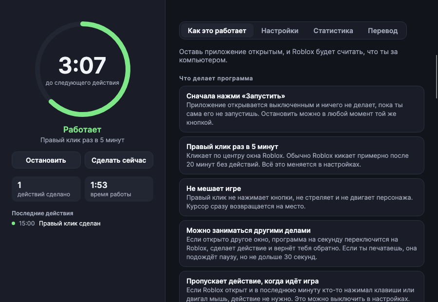
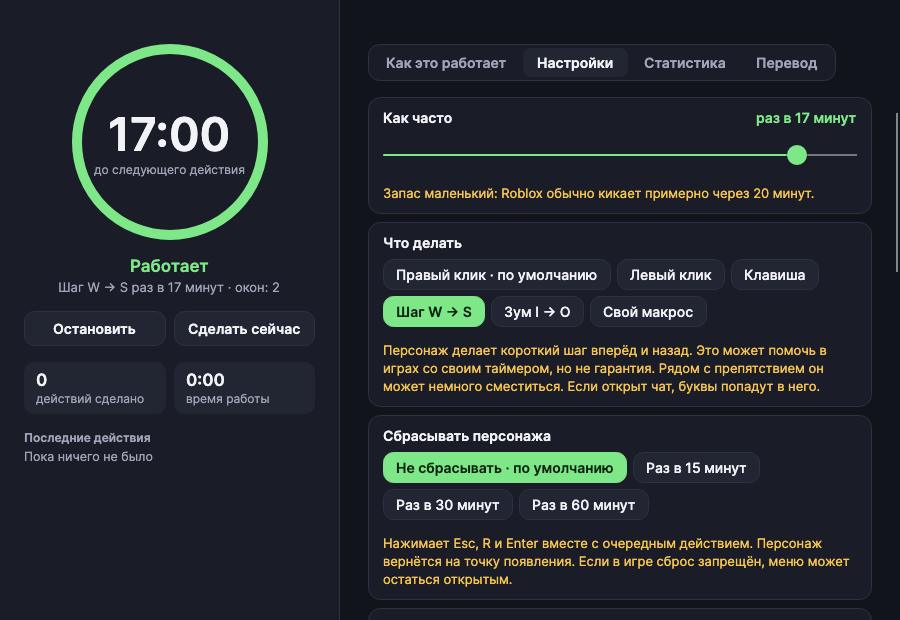
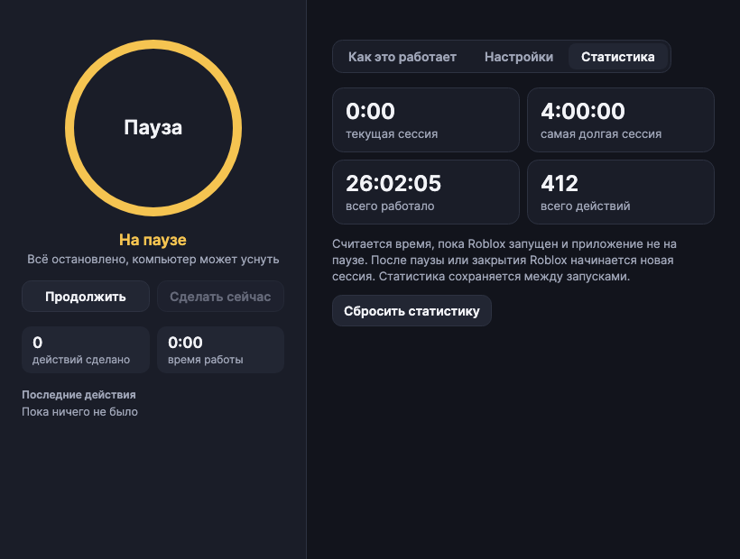
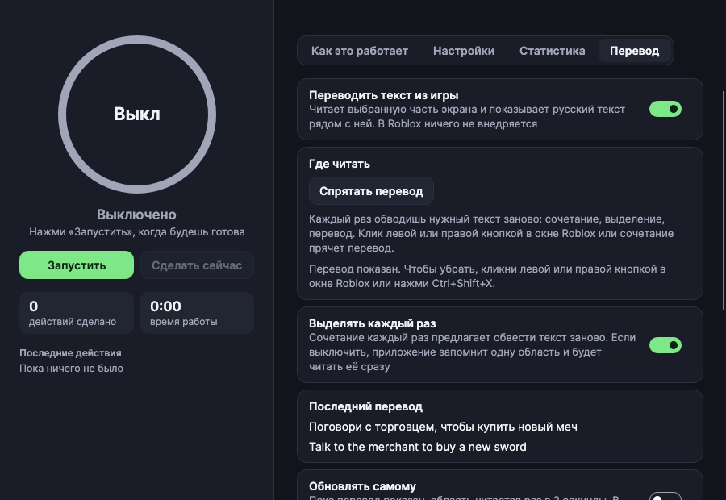
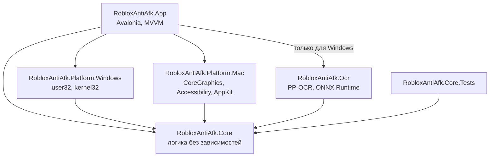

# Roblox AntiAFK

Приложение для Windows и macOS, которое не даёт Roblox кикнуть за бездействие. Раз в несколько минут оно делает одно действие в окне игры: по умолчанию правый клик, который не нажимает кнопки и не двигает персонажа.

## Скачать

**[Открыть страницу релизов](../../releases)** и в последнем релизе, в разделе **Assets**, скачать файл для своей системы:

| Система | Файл |
| --- | --- |
| Windows 10 и 11 (64 бита) | `Roblox AntiAFK.exe` |
| Mac на Apple Silicon (M1 и новее) | `Roblox-AntiAFK-mac-apple-silicon.zip` |
| Mac на Intel | `Roblox-AntiAFK-mac-intel.zip` |

Устанавливать ничего не нужно. Как запустить, описано в разделе [«Запуск»](#запуск).



Клиент Roblox приложение не изменяет: нет инъекций, чтения памяти и правки файлов игры. Оно работает как обычный ввод с мыши и клавиатуры, а текст для перевода читает с экрана.

## Возможности

- **Запуск по кнопке:** приложение открывается выключенным и ничего не делает, пока не нажмёшь «Запустить».
- **Расписание:** действие раз в 1–19 минут, по умолчанию раз в 5.
- **Шесть действий:** правый клик, левый клик, клавиша на выбор, шаг W → S, зум I → O и свой макрос.
- **Свой макрос:** запись клавиш, кликов и движений мыши в окне Roblox, до минуты. Ввод в других окнах не записывается.
- **Своя точка клика:** кликни один раз в окне Roblox, и приложение запомнит место. Этот клик в игру не попадает.
- **Несколько окон:** действие выполняется в каждом открытом окне Roblox по очереди.
- **Не мешает:** возвращает тебя в прежнее окно и на прежнее место курсора, ждёт паузу в наборе текста и пропускает действие, если ты сейчас играешь.
- **Компьютер не засыпает**, пока приложение запущено. Это можно выключить.
- **Переподключение:** если в журнале Roblox появилась запись об отключении, приложение заходит по твоей ссылке. Максимум 5 попыток подряд.
- **Уведомления в Telegram:** через твоего бота, если Roblox отключился или закрылся. Если интернета нет, сообщение отправится, когда он появится.
- **Трей и горячая клавиша:** приложение можно убрать к значку и запускать из любого окна: `Ctrl+Shift+F8` на Windows, `Control+Option+A` на Mac.
- **Сброс персонажа, скрытие окна и выключение звука:** всё выключено по умолчанию. Выключение звука работает только на Windows.
- **Запуск с системой:** приложение может открываться само и сразу начинать работу, если это включить.
- **Перевод текста из игры:** нажми `Ctrl+Shift+X` на Windows или `Control+Option+T` на Mac и обведи текст мышью. Русский перевод появится рядом, а клик левой или правой кнопкой в окне Roblox или то же сочетание его уберёт. В Roblox ничего не внедряется: приложение читает картинку с экрана.
- **Статистика:** список сессий с датой, длительностью и числом действий, самая долгая сессия и общее время.
- **Правила внутри приложения:** всё описано на русском на вкладке «Как это работает».

| Настройки | Статистика | Перевод |
| --- | --- | --- |
|  |  |  |

## Запуск

Устанавливать .NET не нужно, всё необходимое уже внутри приложения.

**Windows.** Открой `Roblox AntiAFK.exe`. Приложение не подписано, поэтому Windows может предупредить о неизвестном издателе: нажми «Подробнее» → «Выполнить в любом случае».

**macOS.** Распакуй архив и при первом запуске открой `Roblox AntiAFK.app` через правый клик → «Открыть». Затем включи приложение в «Системные настройки» → «Конфиденциальность и безопасность» → «Универсальный доступ»: без этого macOS не даст нажимать клавиши и кликать. Для перевода нужно ещё разрешение «Запись экрана» в том же разделе, после него приложение нужно открыть заново. Начиная с версии 1.6.2 при обновлении достаточно заменить старое приложение новым: выдавать разрешения заново не нужно.

После открытия приложение выключено: когда будешь готова, нажми «Запустить».

Если приложение просит разрешение, хотя оно уже включено, удали его из списка кнопкой «−» и добавь снова. Так бывает после пересборки.

## Настройки

| Настройка | Варианты | По умолчанию |
| --- | --- | --- |
| Как часто | от 1 до 19 минут | раз в 5 минут |
| Что делать | правый клик, левый клик, клавиша, шаг W → S, зум I → O | правый клик |
| Куда кликать | по центру окна или своя точка | по центру окна |
| Какая клавиша | Пробел, W, A, S, D, E, F, Q, R, 1, 2, 3 | Пробел |
| Сбрасывать персонажа | не сбрасывать, раз в 15, 30 или 60 минут | не сбрасывать |
| Все окна Roblox | вкл / выкл | вкл |
| Пропускать, когда идёт игра | вкл / выкл | вкл |
| Не давать компьютеру уснуть | вкл / выкл | вкл |
| Прятать Roblox между действиями | вкл / выкл | выкл |
| Выключить звук Roblox (только Windows) | вкл / выкл | выкл |
| Заходить обратно после отключения | вкл / выкл и ссылка на игру | выкл |
| Уведомления в Telegram | токен бота | нет |
| Прятать в трей при закрытии | вкл / выкл | выкл |
| Открывать вместе с системой | вкл / выкл | выкл |
| Запускать сразу при открытии | вкл / выкл | выкл |
| Переводить текст из игры | вкл / выкл и область на экране | выкл |
| Выделять каждый раз | вкл / выкл | вкл |
| Обновлять перевод самому | вкл / выкл, раз в 2 секунды | выкл |
| Ключ DeepL | необязательно | нет |

Настройки и статистика хранятся в `%AppData%\Roblox AntiAFK` на Windows и в `~/Library/Application Support/Roblox AntiAFK` на macOS. Токен Telegram и ключ DeepL лежат там же обычным текстом, поэтому не выкладывай эту папку.

### Как работает перевод

1. Включи перевод на вкладке «Перевод».
2. Когда в игре появится текст, нажми `Ctrl+Shift+X` на Windows или `Control+Option+T` на Mac.
3. Картинка в окне Roblox замрёт, как при скриншоте. Зажми левую кнопку мыши и обведи текст. Этот клик в игру не попадает. Читается именно застывший кадр, поэтому движущийся текст не убежит. Перевод появится рядом. Передумала выделять: нажми Esc или правую кнопку мыши.
4. Чтобы убрать перевод, кликни левой или правой кнопкой в любом месте окна Roblox или снова нажми сочетание. Этот клик в игру не попадает. Потом всё можно повторить с другим текстом.

Если текст всегда появляется в одном месте, выключи «Выделять каждый раз» и выбери область один раз. Тогда сочетание сразу покажет перевод этого места.

Если включить «Обновлять самому», область читается раз в 2 секунды, пока перевод показан.

- **Что уходит в интернет:** только распознанный текст. Снимки остаются на компьютере и нигде не сохраняются. Если в области окажется чат или ник, они тоже уйдут в сервис перевода. Экран читается, только пока Roblox на переднем плане, поэтому текст из других окон туда не попадёт.
- **Сервисы перевода:** DeepL, если указать свой ключ, иначе Google Translate, а если он не ответил, MyMemory. У Google это неофициальный бесплатный адрес, он может перестать отвечать.
- **Распознавание работает на компьютере:** на Windows это модели PP-OCR внутри exe, языковые пакеты и Visual C++ доустанавливать не нужно. На macOS это встроенный в систему Vision.

### Как подключить Telegram

1. Создай бота через [@BotFather](https://t.me/BotFather) и скопируй токен.
2. Напиши своему боту любое сообщение.
3. Вставь токен в настройках и нажми «Подключить». Придёт проверочное сообщение.

Об отключении бот пишет, пока приложение открыто, даже если оно не запущено кнопкой. О закрытии окна и переподключении он пишет только в запущенном приложении. Если интернета нет, сообщение ждёт до 6 часов и уходит с временем события. Если закрыть приложение раньше, неотправленные сообщения пропадут.

## Ограничения

- У игры может быть свой таймер, который следит за движением персонажа. От него клик на месте не спасёт. Может помочь режим «Шаг W → S», но это не гарантия.
- Переподключение срабатывает только по записи об отключении в журнале Roblox и рассчитано на одно окно. Если окно закрылось, приложение только сообщит об этом: его могла закрыть ты сама.
- Короткие ссылки вида `roblox.com/share` для переподключения не подходят, нужна ссылка `roblox.com/games/...` или номер игры.
- Перевод читает только то, что видно на экране. Обычный текст диалогов и меню распознаётся хорошо, а декоративные шрифты, надписи на 3D-объектах и текст на пёстром фоне могут читаться с ошибками. Автообновление и запомненная область читают живой экран, поэтому за быстро движущимся текстом могут не успеть.
- Пока картинка замерла при выделении, сама игра идёт дальше, а нажатые клавиши, кроме Esc, до неё доходят. Выбор отменится сам через 30 секунд.
- Если Roblox на весь экран и подпись не видно, переключи его в оконный режим. На macOS значок приложения на это время пропадает из Dock: иначе система не показывает окна поверх полноэкранных.
- Макрос повторяет запись как есть. Поворот камеры может повториться неточно.
- Ограничения FPS и очистки памяти нет: для этого пришлось бы вмешиваться в процесс или файлы Roblox. FPS можно снизить в настройках самой игры.
- На заблокированном экране приложение ничего не сможет нажать.
- На macOS окно, свёрнутое в Dock, не разворачивается: действие будет пропущено, а приложение напишет об этом. Настройка «Прятать Roblox» использует скрытие приложения, как Cmd+H, и такому окну не мешает.
- Чтобы сделать действие в фоновом окне, приложение ненадолго переключается на Roblox.

Перед использованием сверься с правилами Roblox и конкретной игры. Проект не связан с Roblox Corporation, используй его на свой риск.

## Сборка

Нужен [.NET SDK 10](https://dotnet.microsoft.com/download).

Запустить приложение из исходников:

```bash
dotnet run --project src/RobloxAntiAfk.App
```

Прогнать тесты:

```bash
dotnet test --project tests/RobloxAntiAfk.Core.Tests
```

Собрать релизы для всех систем в папку `dist` (скрипт для Mac, он же подписывает `.app`). Постоянный ключ подписи создаётся один раз и хранится вне репозитория, в `~/Library/Application Support/RobloxAntiAFK-Signing`. Если заменить этот ключ, пользователям Mac придётся выдать разрешения заново.

```bash
./scripts/setup-mac-signing.sh
```

```bash
./scripts/publish.sh
```

Собрать только exe на любой системе:

```bash
dotnet publish src/RobloxAntiAfk.App -c Release -r win-x64 --self-contained -p:PublishSingleFile=true -p:IncludeNativeLibrariesForSelfExtract=true
```

Обновить скриншоты: приложение рисует экраны с подставными данными, не открывая окон и ничего не нажимая.

```bash
dotnet run --project tests/RobloxAntiAfk.App.Screenshots -- docs/screenshots
```

## Архитектура

Зависимости направлены внутрь: логика ничего не знает ни об интерфейсе, ни о конкретной системе.



```text
src/
  RobloxAntiAfk.Core/              Логика без зависимостей от системы и интерфейса
    Domain/                        Настройки, геометрия окна, статистика, снимок состояния
    Abstractions/                  Что требуется от системы: окна, ввод, сон, разрешения
    Services/
      AntiAfkEngine.cs             Расписание, пауза, настройки, выбор точки
      ActionRunner.cs              Одно действие: переключить окно, нажать, вернуть обратно
      MacroRecorder.cs             Запись макроса
      RobloxLogWatcher.cs          Поиск отключений в журнале Roblox
      TelegramNotifier.cs          Сообщения через бота
      ScreenTranslator.cs          Перевод: выбор области, снимок, подпись
      OnlineTranslator.cs          Запросы к сервисам перевода
      TextLayout.cs                Порядок строк и место подписи
      StatisticsTracker.cs         Подсчёт времени и сессий
    Storage/                       Сохранение в JSON
  RobloxAntiAfk.Ocr/               Распознавание текста для Windows
  RobloxAntiAfk.Platform.Windows/  Реализация для Windows
  RobloxAntiAfk.Platform.Mac/      Реализация для macOS
  RobloxAntiAfk.App/               Интерфейс и сборка всех частей
    ViewModels/                    Состояние экранов
    Views/                         Разметка экранов
    Presentation/                  Все тексты на русском
tests/
  RobloxAntiAfk.Core.Tests/        Тесты логики на подставной системе
  RobloxAntiAfk.App.Screenshots/   Отрисовка экранов в PNG
```

Основные решения:

- **Логика отделена от системы.** `AntiAfkEngine` работает только через интерфейсы из `Abstractions`, поэтому её можно проверить тестами без настоящих кликов и без Roblox.
- **Один поток.** Движок работает в потоке интерфейса и использует `async`/`await`, поэтому блокировки не нужны. Там же работает системный перехват мыши.
- **Время подменяется.** Всё ожидание идёт через `IClock`, поэтому тесты не ждут по-настоящему.
- **Ядро не знает языка.** Движок сообщает коды событий, а текст собирает `Presentation/Texts.cs`. Для перевода на другой язык менять логику не придётся.

Чтобы добавить новое действие, допиши значение в `AfkAction`, обработай его в `ActionRunner.SendActionAsync` и добавь тексты в `Texts`. Интерфейс покажет новый вариант сам.

## Состояние проекта

Логика покрыта автотестами. Системные слои проверены только частично:

- **Проверено автоматически:** логика расписания, действий и выбора точки, сохранение настроек, таблицы клавиш, размеры структур Windows, вызовы системы на чтение и логика перевода. Оба распознавателя текста проверяются на картинках, нарисованных прямо в тестах.
- **Проверяется при каждом пуше:** [GitHub Actions](.github/workflows/ci.yml) прогоняет тесты на Windows и macOS, собирает exe и проверяет, что он открывается на Windows и не закрывается сам. Затем в собранном exe проверяется распознавание, снимок экрана и подпись. Готовый exe можно скачать со страницы запуска.
- **Ещё не проверено вживую:** настоящие клики и нажатия в Roblox, выбор точки, запись макроса, трей, горячая клавиша, автозапуск, выключение звука, переподключение, перевод поверх настоящей игры и обход кика в реальной игре. Чтобы проверить основное, нажми «Запустить» и «Сделать сейчас», а затем оставь Roblox примерно на 25 минут.
- **Записи об отключении:** приложение ищет их по строкам `Lost connection with reason` и `Sending disconnect with reason`, код 285 считается обычным выходом. На настоящем кике это ещё не проверено.

## Благодарности

Идеи режимов W → S и зума, макросов, переподключения, сброса персонажа, трея и работы с несколькими окнами подсмотрены в проекте [AntiAFK-RBX](https://github.com/Agzes/AntiAFK-RBX) (MIT). Код написан заново.

Распознавание на Windows использует [RapidOcrNet](https://github.com/BobLd/RapidOcrNet) и модели PP-OCR (Apache-2.0), а также ONNX Runtime (MIT). В exe входят библиотеки Microsoft Visual C++ Runtime, их можно распространять вместе с приложением по условиям Microsoft.

## Лицензия

[MIT](LICENSE)
