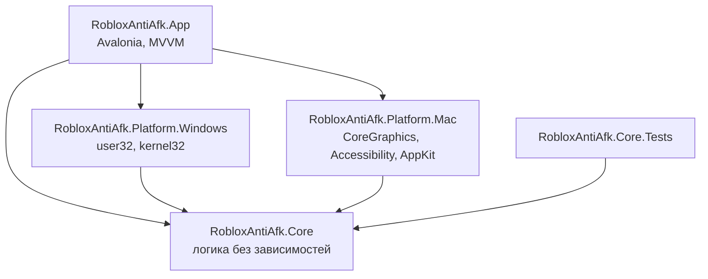

# Roblox AntiAFK

Приложение для Windows и macOS, которое не даёт Roblox кикнуть за бездействие. Раз в несколько минут оно делает одно действие в окне игры: по умолчанию правый клик, который не нажимает кнопки и не двигает персонажа.

## Скачать

**[Открыть страницу релизов](../../releases)** и в последнем релизе, в разделе **Assets**, скачать файл для своей системы:

| Система | Файл |
| --- | --- |
| Windows 10 и 11 (64 бита) | `Roblox AntiAFK.exe` |
| Mac на Apple Silicon (M1 и новее) | `Roblox-AntiAFK-mac-apple-silicon.zip` |
| Mac на Intel | `Roblox-AntiAFK-mac-intel.zip` |

Устанавливать ничего не нужно. Как запустить, описано в разделе [«Запуск»](#запуск).


Клиент Roblox приложение не изменяет: нет инъекций, чтения памяти и правки файлов игры. Оно работает как обычный ввод с мыши и клавиатуры.

## Возможности

- **Запуск по кнопке:** приложение открывается выключенным и ничего не делает, пока не нажмёшь «Запустить».
- **Расписание:** действие раз в 1–19 минут, по умолчанию раз в 5.
- **Пять действий:** правый клик, левый клик, клавиша на выбор, шаг W → S и зум I → O.
- **Своя точка клика:** кликни один раз в окне Roblox, и приложение запомнит место. Этот клик в игру не попадает.
- **Несколько окон:** действие выполняется в каждом открытом окне Roblox по очереди.
- **Не мешает:** возвращает тебя в прежнее окно и на прежнее место курсора, ждёт паузу в наборе текста и пропускает действие, если ты сейчас играешь.
- **Компьютер не засыпает**, пока приложение запущено. Это можно выключить.
- **Статистика:** список сессий с датой, длительностью и числом действий, самая долгая сессия и общее время.
- **Правила внутри приложения:** всё описано на русском на вкладке «Как это работает».

| Настройки | Статистика |
| --- | --- |
|  |  |

## Запуск

Устанавливать .NET не нужно, всё необходимое уже внутри приложения.

**Windows.** Открой `Roblox AntiAFK.exe`. Приложение не подписано, поэтому Windows может предупредить о неизвестном издателе: нажми «Подробнее» → «Выполнить в любом случае».

**macOS.** Распакуй архив и при первом запуске открой `Roblox AntiAFK.app` через правый клик → «Открыть». Затем включи приложение в «Системные настройки» → «Конфиденциальность и безопасность» → «Универсальный доступ»: без этого macOS не даст нажимать клавиши и кликать.

После открытия приложение выключено: когда будешь готова, нажми «Запустить».

Если приложение просит разрешение, хотя оно уже включено, удали его из списка кнопкой «−» и добавь снова. Так бывает после пересборки.

## Настройки

| Настройка | Варианты | По умолчанию |
| --- | --- | --- |
| Как часто | от 1 до 19 минут | раз в 5 минут |
| Что делать | правый клик, левый клик, клавиша, шаг W → S, зум I → O | правый клик |
| Куда кликать | по центру окна или своя точка | по центру окна |
| Какая клавиша | Пробел, W, A, S, D, E, F, Q, R, 1, 2, 3 | Пробел |
| Все окна Roblox | вкл / выкл | вкл |
| Пропускать, когда идёт игра | вкл / выкл | вкл |
| Не давать компьютеру уснуть | вкл / выкл | вкл |

Настройки и статистика хранятся в `%AppData%\Roblox AntiAFK` на Windows и в `~/Library/Application Support/Roblox AntiAFK` на macOS.

## Ограничения

- У игры может быть свой таймер, который следит за движением персонажа. От него клик на месте не спасёт. Может помочь режим «Шаг W → S», но это не гарантия.
- Если Roblox отключился из-за сети или перезапуска сервера, приложение не зайдёт обратно само.
- На заблокированном экране приложение ничего не сможет нажать.
- На macOS свёрнутое окно Roblox не разворачивается: действие будет пропущено, а приложение напишет об этом.
- Чтобы сделать действие в фоновом окне, приложение ненадолго переключается на Roblox.

Перед использованием сверься с правилами Roblox и конкретной игры. Проект не связан с Roblox Corporation, используй его на свой риск.

## Сборка

Нужен [.NET SDK 10](https://dotnet.microsoft.com/download).

Запустить приложение из исходников:

```bash
dotnet run --project src/RobloxAntiAfk.App
```

Прогнать тесты:

```bash
dotnet test --project tests/RobloxAntiAfk.Core.Tests
```

Собрать релизы для всех систем в папку `dist` (скрипт для Mac, он же подписывает `.app` локальной подписью):

```bash
./scripts/publish.sh
```

Собрать только exe на любой системе:

```bash
dotnet publish src/RobloxAntiAfk.App -c Release -r win-x64 --self-contained -p:PublishSingleFile=true -p:IncludeNativeLibrariesForSelfExtract=true
```

Обновить скриншоты: приложение рисует экраны с подставными данными, не открывая окон и ничего не нажимая.

```bash
dotnet run --project tests/RobloxAntiAfk.App.Screenshots -- docs/screenshots
```

## Архитектура

Зависимости направлены внутрь: логика ничего не знает ни об интерфейсе, ни о конкретной системе.



```text
src/
  RobloxAntiAfk.Core/              Логика без зависимостей от системы и интерфейса
    Domain/                        Настройки, геометрия окна, статистика, снимок состояния
    Abstractions/                  Что требуется от системы: окна, ввод, сон, разрешения
    Services/
      AntiAfkEngine.cs             Расписание, пауза, настройки, выбор точки
      ActionRunner.cs              Одно действие: переключить окно, нажать, вернуть обратно
      StatisticsTracker.cs         Подсчёт времени и сессий
    Storage/                       Сохранение в JSON
  RobloxAntiAfk.Platform.Windows/  Реализация для Windows
  RobloxAntiAfk.Platform.Mac/      Реализация для macOS
  RobloxAntiAfk.App/               Интерфейс и сборка всех частей
    ViewModels/                    Состояние экранов
    Views/                         Разметка экранов
    Presentation/                  Все тексты на русском
tests/
  RobloxAntiAfk.Core.Tests/        Тесты логики на подставной системе
  RobloxAntiAfk.App.Screenshots/   Отрисовка экранов в PNG
```

Основные решения:

- **Логика отделена от системы.** `AntiAfkEngine` работает только через интерфейсы из `Abstractions`, поэтому её можно проверить тестами без настоящих кликов и без Roblox.
- **Один поток.** Движок работает в потоке интерфейса и использует `async`/`await`, поэтому блокировки не нужны. Там же работает системный перехват мыши.
- **Время подменяется.** Всё ожидание идёт через `IClock`, поэтому тесты не ждут по-настоящему.
- **Ядро не знает языка.** Движок сообщает коды событий, а текст собирает `Presentation/Texts.cs`. Для перевода на другой язык менять логику не придётся.

Чтобы добавить новое действие, допиши значение в `AfkAction`, обработай его в `ActionRunner.SendActionAsync` и добавь тексты в `Texts`. Интерфейс покажет новый вариант сам.

## Состояние проекта

Логика покрыта автотестами. Системные слои проверены только частично:

- **Проверено автоматически:** логика расписания, действий и выбора точки, сохранение настроек, таблицы клавиш, размеры структур Windows и вызовы системы на чтение.
- **Проверяется при каждом пуше:** [GitHub Actions](.github/workflows/ci.yml) прогоняет тесты на Windows и macOS, собирает exe и проверяет, что он открывается на Windows и не закрывается сам. Готовый exe можно скачать со страницы запуска.
- **Ещё не проверено вживую:** настоящие клики и нажатия в Roblox, выбор точки и обход кика в реальной игре. Чтобы проверить, нажми «Запустить» и «Сделать сейчас», а затем оставь Roblox примерно на 25 минут.

## Благодарности

Идеи режимов W → S и зума, работы с несколькими окнами и статистики подсмотрены в проекте [AntiAFK-RBX](https://github.com/Agzes/AntiAFK-RBX) (MIT). Код написан заново.

## Лицензия

[MIT](LICENSE)
